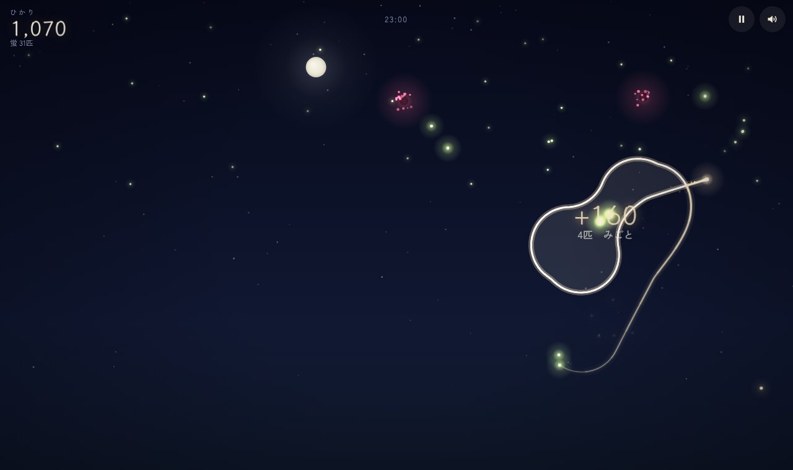
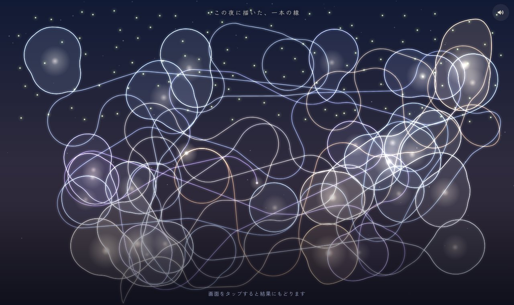

# one-line-games

一本の線で作る作品、ゲームの置き場。

作品はそれぞれ別のブランチに置く。
他のブランチは、作品が完成するまで見ないこと。

---

## ひとすじ

光の線で蛍をぐるりと囲むゲーム。画面の中にある線は、プレイヤーが引く一本だけです。
夜のはじめから夜明けまで、線は一度もとぎれずに伸びつづけます。遊び終わると、その夜に描いた一本の線が一枚の絵として残ります。

### 遊び方

- 線の先は、指やマウスを追いかけて進みつづけます。止めると、そのまわりをぐるりと回ります。
- 線が自分と交わって輪ができると、内側の蛍がつかまり、夜空の星になります。得点は囲んだ数の2乗×10（3匹なら90、5匹なら250）。
- 金色にすばやく瞬くヒメボタルは、3匹ぶんに数えます。
- 赤い渦「かまいたち」に線の先が触れたら、糸が切れておしまい。線の途中に触れられると、そこから後ろが切れます。かまいたちは囲めば封じられます（1匹100）。
- 月が沈むまでの2分間（ゲームの中の時刻で19:50から4:30まで）線を切らさずにいると、夜明けのボーナスが500つきます。
- キーボードでは ← → で曲がれます。P で一時停止、M で音の入り切り。

### 遊ぶには

`index.html` をブラウザで開くだけです。ビルドも外部のライブラリもいりません。フォントだけ Google Fonts から読み込み、読み込めないときは端末のフォントで表示します。

### 夜明けに残る絵

夜のはじめから最後までの線の先の通り道を、時刻に合わせて色を変えながら重ねた絵です。宵の紫から真夜中の青白さを通って、夜明けの金色へ移ります。蛍を囲んだ輪はひときわ明るく残ります。結果画面の「絵を保存」で PNG にできます。

### つくり

- 一枚の HTML に、Canvas 2D の描画と Web Audio で合成した音（鈴の音、鈴虫、糸の切れる音）をまとめています。
- 線は、先端の通った跡を決まった長さだけ残したものです。先端が進むたびに新しい線分と古い線分の交差を調べ、交わったらその間を多角形として切り出して、内側にいる蛍を数えます。
- ゲンジボタルは群れごとにそろって、西日本の蛍にならい約2秒ごとにゆっくり明滅します。ヒメボタルは短く速く点滅します。
- 画面の向きや大きさが変わっても遊びやすさが同じになるよう、短いほうの辺を600として座標を決めています。
